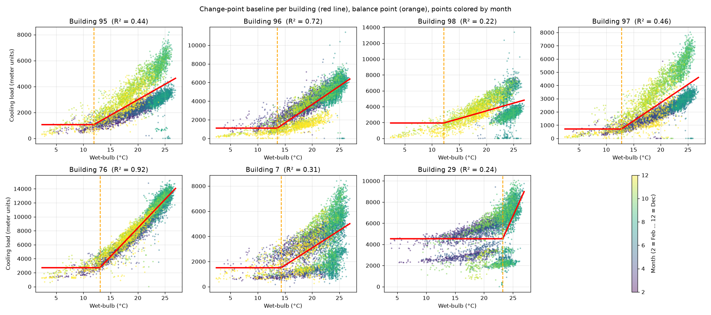
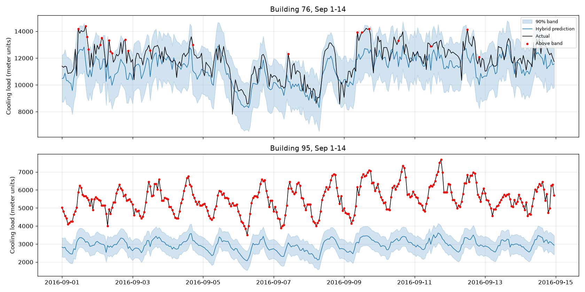
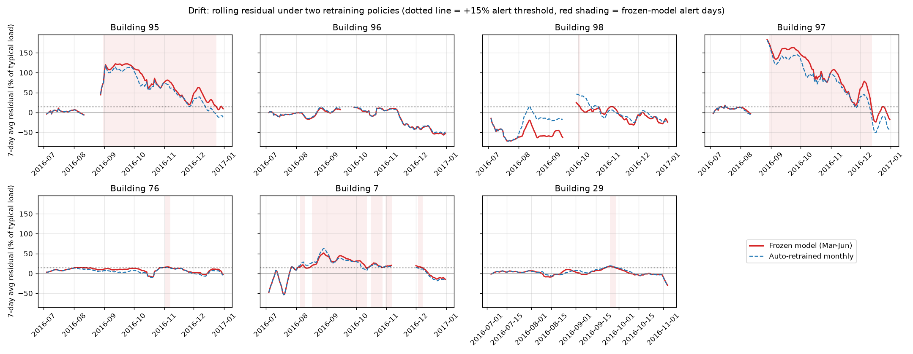

# Cooling Check

**A physics + ML hybrid for spotting cooling waste.** A change-point weather baseline, an ML model for schedules, and conformal 90% prediction bands flag buildings using more chilled water than the weather explains.

In other words: **weather-normalized anomaly detection for building cooling.** Cooling Check flags buildings that use more chilled water than the weather explains, and estimates what the excess costs in dollars and CO2.

It was built for **facility operators**: people who need a short, trustworthy list of buildings to look at, not a dashboard of raw meter readings.

It is a portfolio project, not a production system.

## Why weather-normalize?

Comparing cooling use month to month is misleading, because the weather changes as the seasons change. Comparing to the day before, or to the same day last year, gets closer, but the weather still won't match: one July can be hotter than another.

Cooling Check compares each hour's actual cooling to what that hour's weather says the building should use. Running the chiller hard on a hot, humid afternoon is expected. Running it just as hard on a mild day means something is wrong, either with the equipment or with how it is operated.

## Approach

| Step | What it does |
|---|---|
| Data | ASHRAE GEPIII chilled water meters, one site (University of Central Florida, Orlando), 7 large buildings, 2016. Suspect hours are flagged, not deleted. |
| Physics features | Wet-bulb temperature and enthalpy from air temperature and dew point (psychrometrics). |
| Physics baseline | A 3-parameter cooling change-point model per building (ASHRAE Guideline 14 style): flat base load below a wet-bulb balance point, linear rise above it. |
| ML on the gap | Gradient boosting on what the baseline misses (hour of day, day of week, humidity). Hybrid = baseline + residual model. |
| Uncertainty | 90% prediction bands by split conformal prediction, with real coverage reported. |
| Backtest | Rolling-origin, month by month: always fit on the past, calibrate on the month before, test on the next month. |
| New buildings | Cold start with 3 weeks of data: learn alone vs. pool from other buildings and adapt. |
| Drift | 7-day rolling residual with an alert rule; frozen vs. auto-retrained model. |
| Flag and quantify | Trust gate, verdict per building, excess cooling in ton-hours, dollars, and CO2. |

## Main results

**Verdicts, August to December 2016:**

| Building | Use | Hours above the 90% band | Verdict | Excess cooling | Potential savings | CO2 |
|---|---|---|---|---|---|---|
| 97 | Residence hall | 69.9% | Flagged | 298,874 ton-hours (33% of its cooling) | $33,036 | 111 t |
| 95 | Residence hall | 76.9% | Flagged | 280,669 ton-hours (28%) | $31,024 | 104 t |
| 29 | Education | 9.5% | Within expected range (borderline) | | | |
| 76 | Education | 6.0% | Within expected range | | | |
| 96 | Residence hall | 4.6% | Within expected range | | | |
| 7 | Education | 2.7% | Can't judge (model failed the accuracy check) | | | |
| 98 | Residence hall | 0.0% | Can't judge (model failed the accuracy check) | | | |

**Potential savings for the two flagged buildings: about $64,000 and 216 tonnes of CO2 over five months, conservatively estimated.**

- **Why conservative:** only cooling above the band's upper edge counts as excess, and only for flagged buildings. Measured from the prediction instead, the same two buildings come to about $90,000 and 303 tonnes, 1.41 times more.
- **Assumptions:** a chiller plant efficiency (COP) of 3.5. Across COP 2.5 to 5.0, the band-edge estimate ranges from about $45,000 to $90,000 and 151 to 302 tonnes of CO2.
- **Potential, not realized:** buildings 95 and 97 both came back from a data outage in late August using roughly twice the cooling the weather explains. **These savings assume the extra cooling is real and gets fixed. A meter change could produce the same pattern, so the first step for an operator would be to check the meter.**

**Other key numbers:**

- **Physics baseline:** six of seven buildings start needing more cooling above a wet-bulb of about 53 to 58°F. The best-fitting building has R² = 0.92.
- **Model comparison** (median error across buildings, Aug to Dec): baseline 42.5%, ML alone 32.4%, hybrid 35.5%. ML alone was slightly more accurate; I kept the hybrid because it stays explainable (weather part plus schedule part) and is close everywhere except one building with little training data.
- **Uncertainty:** the 90% band covered 68.4% of hours overall. For the most stable building it covered 91.9%. The shortfall comes mostly from buildings whose behavior changed, which is the signal the tool is meant to catch.
- **Backtest:** monthly coverage rose from 74% in June to 93% in October as history grew.
- **New buildings:** pooling from other buildings gave honest bands (median coverage 95.9% vs. 61.6% when learning a new building alone), but it did worse on error for the two education buildings, whose daily schedule differs from the residence halls that dominate the pool.
- **Drift:** the alert rule caught buildings 95 and 97 on August 30. Automatically recalibrating the band each month widened it about six times and silenced the alert within a month, which argues for retraining only after a person reviews an alert.

## Data validation

I cleaned the raw Kaggle files myself, then checked my work against the dataset authors' corrected release (Building Data Genome 2):

- **Units:** the Kaggle chilled water readings equal the authors' kWh values times 3.412 in every hour, so they are in kBTU.
- **Time zones:** the Kaggle weather is in UTC, and this site's local time is a fixed UTC minus 5 hours with no daylight saving. My first fix applied daylight saving and was one hour off in summer; the check caught it, and every section was re-run after the correction.

## How far to trust it

There are no confirmed real faults in this data, so I tested the method by **planting faults**: multiplying a building's readings by 1.10, 1.25 or 1.50 from a chosen date, then checking what the tool says on month-end dates (`scripts/as_of_test.py`). I also ran the same, unchanged pipeline on three other sites (Tempe AZ, Princeton NJ, Austin TX) from the same dataset (`scripts/compare_sites.py`).

- **Reproducible:** `tests/reproduce_orlando.py` checks that the reusable pipeline gives the notebook's exact verdicts and totals. Run through the dataset authors' own files, Orlando gives the same verdicts.
- **Other sites:** the tool judged 5 of 7 buildings in Orlando, 6 of 7 in Tempe, 2 of 7 in Princeton and 3 of 7 in Austin. The rest were marked "Can't judge" rather than guessed.
- **Planted faults, checked at month end** (16 judged buildings in 2016; 19 in 2017, which the rule never saw): a +50% fault was flagged in about 55% of checks while it was running, +25% in about 25%, +10% rarely. The 2017 results were close to 2016 (+50%: 53%, +25%: 23%, +10%: 7%).
- **After a fix:** about 54 to 62% of the time the tool said "was flagged, back to normal"; about 5 to 8% of the time it still said "ongoing".
- **Quiet buildings:** with the 5% materiality floor, about a quarter of unmodified judged buildings still showed an alert episode. I cannot say how many are false alarms, because there are no labels.

**What this does not show:** a planted fault is a steady percentage increase, not a real fault; the buildings come from four university campuses; the thresholds were tuned on 2016 after seeing results.

## Limits

- **Small scope:** the notebook covers one site, seven buildings, one year. The extra tests use four university sites, and only 2 to 6 of 7 buildings per site could be judged, so results may not generalize to other climates or building types.
- **Simple physics:** a single wet-bulb change-point model. It fits poorly when a building has several operating regimes in one year.
- **Not a forecast:** the model uses each hour's measured weather, so it judges hours after they happen.
- **No calendar data:** the academic calendar (for example, summer break) is not modeled. This likely explains building 7's elevated fall readings; the trust gate kept it from being flagged.
- **Assumptions in dollars and CO2:** COP 3.5, a recent Florida commercial electricity price of $0.11/kWh applied to 2016 data, and a Florida grid factor of 0.37 kg CO2/kWh (EPA eGRID2022).
- **Thresholds I chose:** the stuck-meter rule (below 10% of normal for 7+ days), the flag rule (more than 10% of hours above the band), and the drift alert (more than 15% above expected for 3+ days) are my own choices, not published standards.
- **Minor leakage:** the cleaning rules look slightly ahead in time, and some design choices were made after seeing the full year. A live system would flag bad data with a delay.
- **Bands:** one fixed, symmetric width per building, calibrated on a single month (July). Because the band does not shrink in the cool season, a +25% fault is about 1.1 times the band width in August but 0.3 times in December, so relative faults are hard to see in low-load months. I tried a band that scales with load; at the same alert level it was not better, so I kept the fixed band.
- **Zero-run rule:** dropping zero runs longer than 24 hours assumes a warm climate. In a cold climate, winter zeros may be a chiller that is off, not bad data.
- **Flag rule is slow:** the notebook's rule needs more than 10% of the whole test period above the band. The as-of scoring (`status_as_of` in `pipeline.py`) uses a rolling 7-day window instead.

## What production would need

- **A data pipeline:** scheduled ingestion of meter and weather data (on AWS, for example: raw files in S3, scheduled jobs for cleaning and scoring), with the data quality checks from this notebook running automatically.
- **Monitoring:** track each building's real coverage and error over time, and alert on data problems (zero runs, stuck meters, gaps) separately from performance problems.
- **Retraining with review:** retrain or recalibrate only after a person reviews an alert and decides whether it is a problem to fix or a legitimate change.
- **More context:** academic calendars and occupancy, more years of history (the authors' release includes 2017), and pooling by building type for new buildings.
- **Better bands:** calibrate by season and separately above and below the prediction.

## How to run

1. Download `train.csv`, `weather_train.csv`, and `building_metadata.csv` from the [ASHRAE Great Energy Predictor III competition](https://www.kaggle.com/c/ashrae-energy-prediction) into a folder named `ashrae-energy-prediction/` next to the notebook.
2. Install the package versions used for the committed outputs (Python 3.12): `pip install -r requirements.txt`
3. Open `cooling_check.ipynb` and run it top to bottom.

## Data source

Miller, C., Kathirgamanathan, A., Picchetti, B. et al. (2020). *The Building Data Genome Project 2, energy meter data from the ASHRAE Great Energy Predictor III competition.* Scientific Data 7, 368. https://doi.org/10.1038/s41597-020-00712-x
